# 화면 갤러리 (v2 · 2026-09-20)

데모 데이터(`/?demo=12`, `/?demo=15`) 기준 캡처. 전체 페이지 캡처라 하단 내비가 중간에 겹쳐 보이는 컷이 있는데 실제로는 화면 하단 고정입니다.

## 로그인 — Google · Apple · 카카오 · 이메일 · 게스트 (로컬 모의 인증)

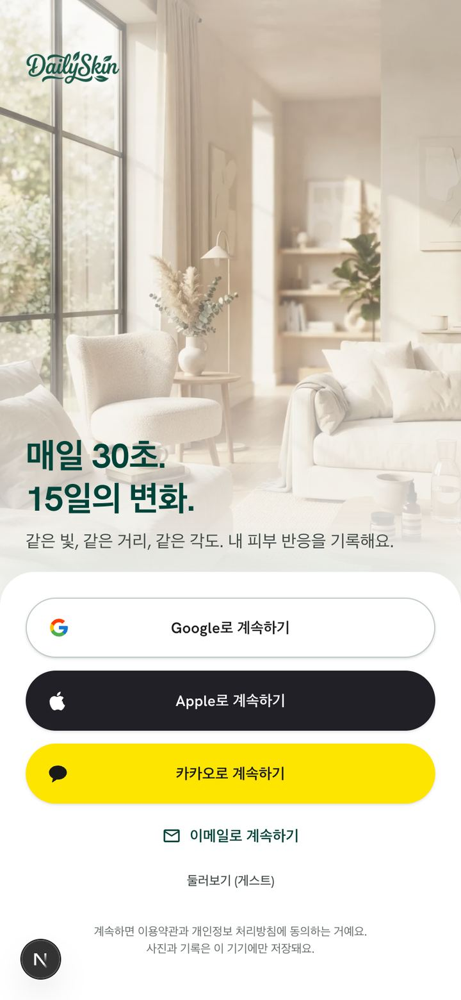

## Today — 점수 히어로, 실험 상태, 30초 체크인, Skin Coach

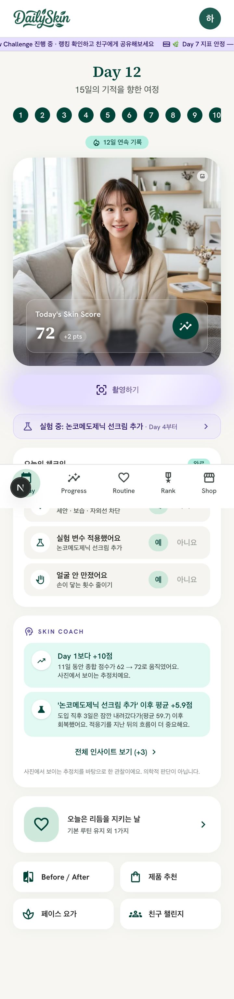

## Progress — 습관 4타일, 실험 시작선·루틴 점이 찍힌 반응 그래프, 루틴 vs 건너뛴 날

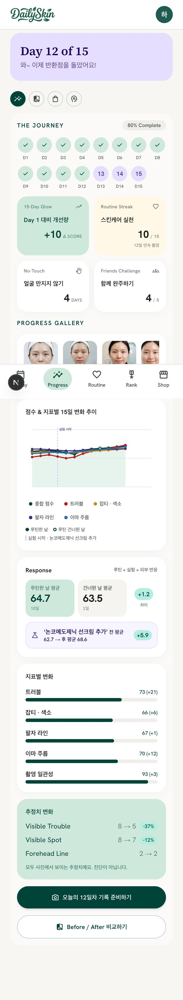

## Progress · Coach 탭 — 전체 인사이트

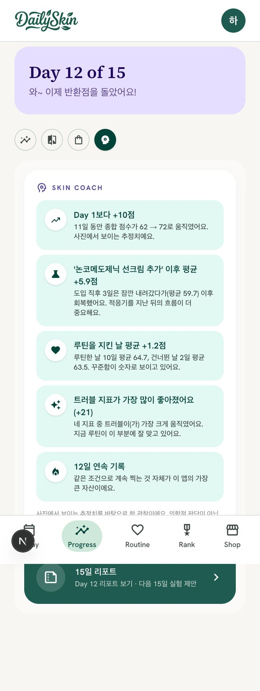

## 실험 설정 — 15일에 변수 하나만

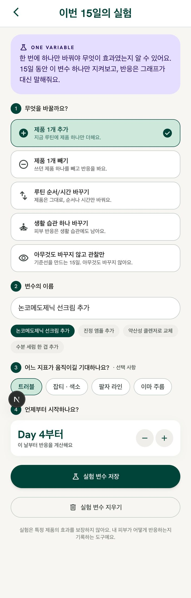

## Day 12 리포트 — 스텝 차트, 지표 델타, 실험 판정, AI Coach

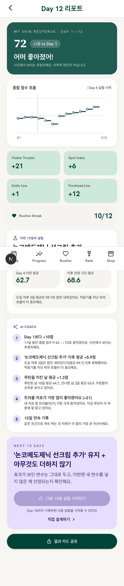

## 15일 완주 리포트 — 다음 15일 실험 시작 (사이클 아카이브)

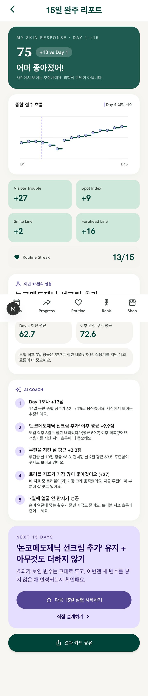

## Friends Challenge — 초대코드, 함께 완주 진행률, 얼굴 없는 결과 카드

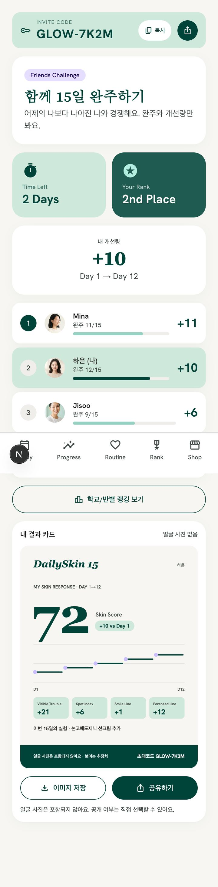

## Face Scan — LIGHT/FOCUS/FRAME/ANGLE/QUALITY 연속성 스트립 (가짜 카메라 입력)

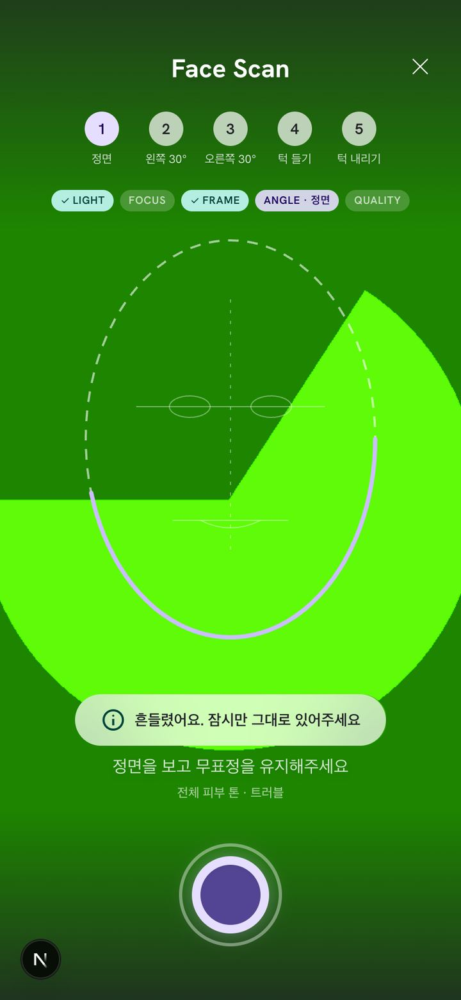

## 프로필 — Skin Memory, 데모 시드

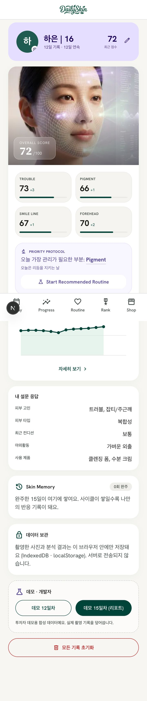

## 설정 — 계정, 촬영 리마인더, 촬영 옵션, 햅틱, 데이터 내보내기

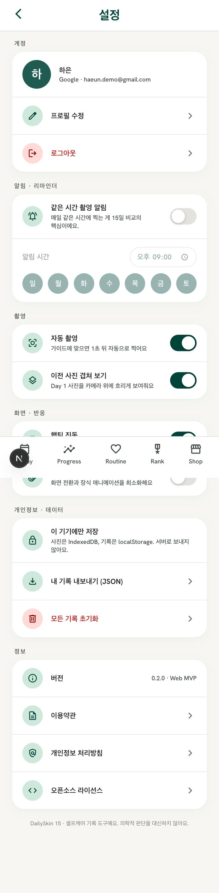

## 학교/반 랭킹 — Glow Board 이니셜 아바타 (얼굴 노출 없음)

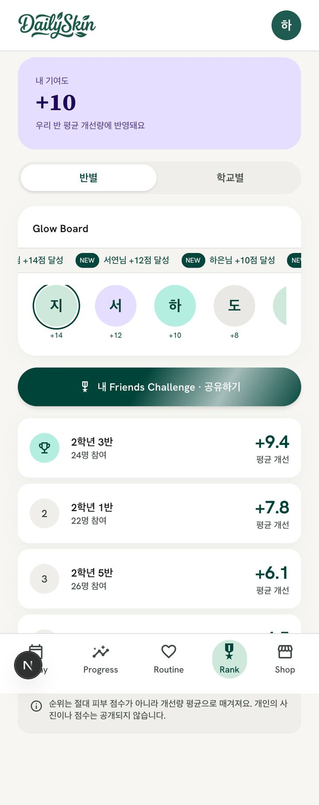

## 분석 결과 — Skin Age Index "내 나이 기준 ±N"

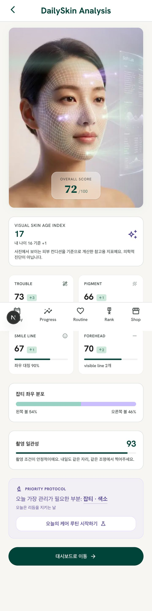

## 페이스 요가

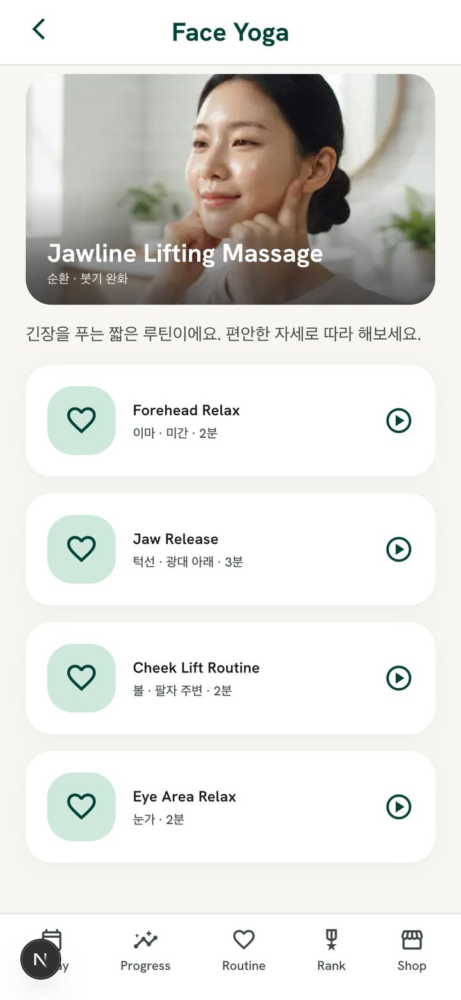

## Shop — 실제 제품 카탈로그 (Open Beauty Facts + K-뷰티 큐레이션)

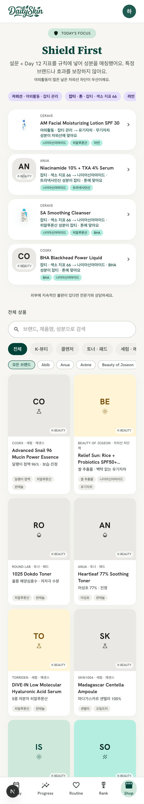

## 제품 시트 — 대표 성분, 전성분, "이 제품으로 15일 실험하기"

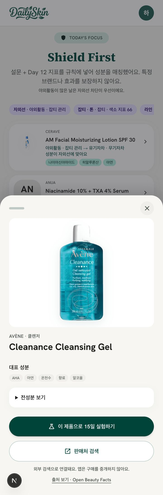

## 분석 결과 — 지표 × 성분 매칭 제품 3

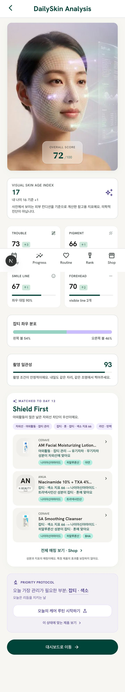

## Today — 오늘의 매칭 제품

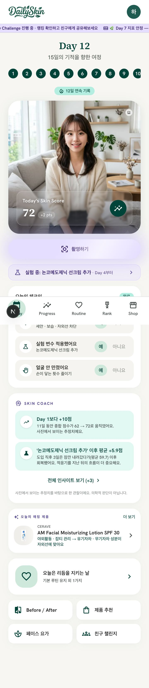
